**Data analyst in the making: Excel, SQL and data visualization, backed by an accounting & finance degree and hands-on school administration experience.**

- 📊 Building my career in **data analytics** and **data visualization**
- 🎓 Pursuing a **BBA** at Virtual University of Pakistan
- 📚 Currently learning: *Data Analytics Basics for Everyone* (edX)
- 🏫 Currently working as a **CRO** at The Pioneers School System
- 🗣️ Languages: English (professional), Urdu and Punjabi (native)

| Role | Organization | Period | Highlights |
|------|--------------|--------|------------|
| CRO | The Pioneers School System | Current | Current role |
| Data Analytics Job Simulation (virtual) | Deloitte, via Forage | Jul 2026 – Oct 2026 | Completed the data analytics job simulation |
| School Administrative Assistant | School | 2023 – 2025 | Managed employee and student records and digital documentation; maintained fee records and tracked institutional expenses in MS Excel; handled official email correspondence between staff, students and administration |
| Teacher | Alimiraj High School | 1 year | Teaching |

- **Regional Sales Analytics Dashboard** (2026)
- **Dynamic Expense Tracking Dashboard** (2026)
- **Student Assignment Tracker** (2026)
- **Dunhill Tobacco Company case study** (2023, GCUF): global operations, history and market positioning

**Backend / Programming**

**Frontend**

**Cloud & DevOps**

**Databases**

**Tools**

| Area | Competencies |
|------|--------------|
| Data | Data Analytics, Data Visualization, MS Excel, Google Sheets, SQL |
| Management | Project Coordination, Event Management, Administration, Workflow Optimization |
| Digital | Digital Marketing, Client Relationship, Canva, Notion, MS Office |
| Core Skills | Leadership, Teamwork, Communication, Problem Solving, Adaptability, Detail Oriented |

**Education**

- 🎓 **Bachelor of Business Administration**, Virtual University of Pakistan (2025 – Present)
- 🎓 **Associate Degree in Accounting & Finance**, Government College University Faisalabad (2021 – 2023)

**Certifications**

- Business Analytics with Excel, Microsoft & Simplilearn SkillUp (28 Sep 2026)
- Introduction to MS Excel, Microsoft & Simplilearn SkillUp (15 Sep 2026)
- Microsoft Excel 365: From Beginner to Pro, Alison (completed 09 Sep 2026)
- Data Analytics Job Simulation, Deloitte via Forage (Jul – Oct 2026)
- Graphic Designing
- Data Analytics Basics for Everyone, edX (in progress)

*Always learning, one dataset at a time.*

